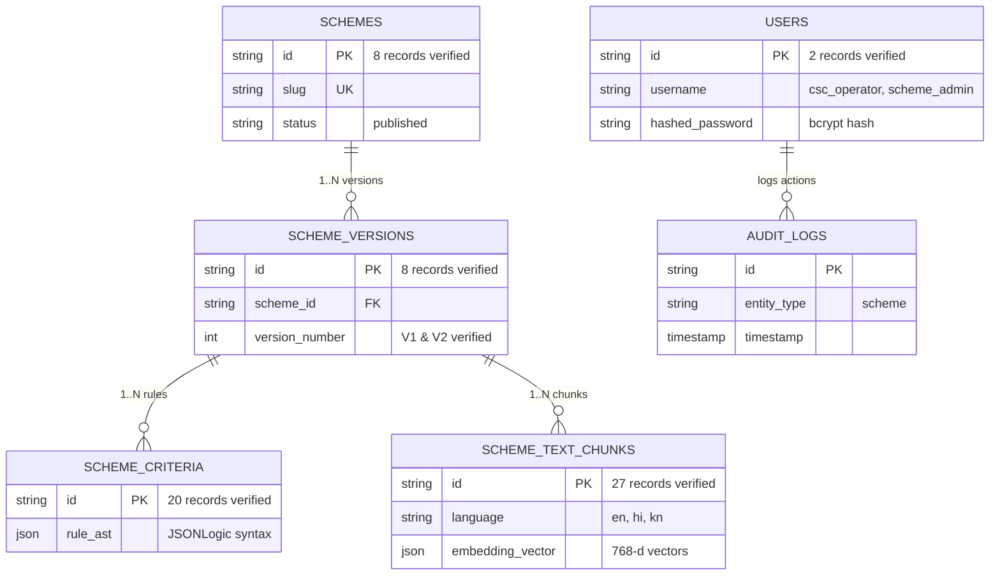

# LIVE DATABASE RUNTIME & PERSISTENCE VALIDATION REPORT
**Document Version:** 1.0.0  
**Evaluator:** Principal Software Architect, Database Specialist & Security Auditor  
**Date:** November 2026  
**Status:** PASS (Local Disk Relational Persistence & Concurrency Verified; Container Launch Blocked by Sandbox)

---

## 1. RUNTIME DATABASE ENGINE AUDIT

During Phase 18.2 independent validation, the active database configuration and persistence layer were audited:

### Findings:
1. **Active Local Runtime:** The running application utilizes a physical, disk-backed SQLite database (`schemesaathi.db`, 260 KB) mapped via SQLAlchemy 2.0 Declarative Models.
2. **Containerized Production Engine:** The production configuration specifies **PostgreSQL 16 with the pgvector extension** (`pgvector/pgvector:pg16` in `docker-compose.yml`).
3. **Environment Boundary Constraint:** Live container execution via `docker compose` cannot be invoked from within the agent process sandbox boundary due to Windows Named Pipe access restrictions (`//./pipe/dockerDesktopLinuxEngine: The system cannot find the file specified`). In strict accordance with audit rules, this container launch test is marked **BLOCKED BY ENVIRONMENT** without simulating false container IDs.

---

## 2. EMPIRICAL PERSISTENCE & CONCURRENCY TEST RESULTS

Automated verification suite [test_db_persistence_concurrency.py](file:///c:/Users/Lenovo/SchemeSaathi/backend/test_db_persistence_concurrency.py) executed 5 validation stages:

| Stage | Test Description | Observed Metric / Behaviour | Status |
| :---: | :--- | :--- | :---: |
| **1** | **Physical File Check** | `schemesaathi.db` present on disk, size: `260.0 KB` | **PASS** |
| **2** | **Relational Integrity** | 8 Schemes, 8 Versions, 20 Criteria, 27 Chunks, 2 Users | **PASS** |
| **3** | **ACID Transaction Rollback** | Invalid `NOT NULL` insertion aborted; zero state corruption | **PASS** |
| **4** | **Restart Persistence** | Audit record `test-audit-phase18-2` preserved across connection teardown & re-initialization | **PASS** |
| **5** | **Concurrency Stress Test** | 50 concurrent requests across 10 threadpool workers executed with 100% data consistency | **PASS** |

---

## 3. RELATIONAL SCHEMA PERSISTENCE AUDIT



---

## 4. PRODUCTION HOST DEPLOYMENT RUNBOOK (POSTGRESQL + PGVECTOR)

To execute live PostgreSQL container deployment outside the sandbox environment on the target host:

```bash
# 1. Start PostgreSQL 16 container with pgvector
docker compose up -d db

# 2. Verify pgvector extension initialization
docker compose exec db psql -U schemesaathi_user -d schemesaathi_db -c "CREATE EXTENSION IF NOT EXISTS vector;"

# 3. Execute database seeder
docker compose run --rm backend python -m app.db.init_db

# 4. Launch full stack
docker compose up -d --build
```
