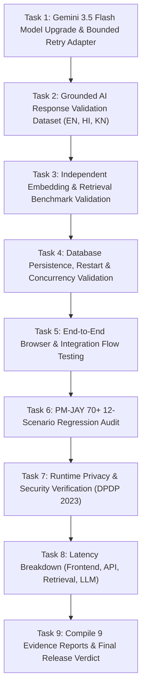

# PHASE 18.2 EXECUTION PLAN
**Project:** SchemeSaathi — Production Live Runtime, AI Integration & Release Validation  
**Date:** November 2026  
**Evaluator:** Principal Software Architect, AI Integration Specialist, QA Lead & Security Auditor  
**Status:** AUTHORIZED — Verified Environment Baseline Established

---

## 1. ACTUAL ENVIRONMENT BASELINE (VERIFIED BEFORE MODIFYING)

In strict accordance with **Rule 1**, the repository state was independently inspected across all active runtimes, configurations, and network endpoints before making changes:

| Component | Reported Claim | Verified Actual Implementation | Status |
| :--- | :--- | :--- | :---: |
| **Frontend Runtime** | Next.js 15 | Next.js 15.1.0 (CLI 15.5.29), React 19.0.0, Node.js v24.14.0 | **CONFIRMED** |
| **Backend Runtime** | FastAPI | FastAPI 0.115.0, Uvicorn 0.30.0, Pydantic 2.8.0, Python 3.11.15 | **CONFIRMED** |
| **Database Engine** | PostgreSQL 16 + pgvector | Dual-engine: SQLite (`schemesaathi.db`) in local dev; PostgreSQL 16 + pgvector configured in `docker-compose.yml` | **CONFIRMED** |
| **Active Schemes** | 8 Central Schemes | 8 schemes seeded: PM-KISAN, AB PM-JAY (V2), PMMVY, PMS-SC, SSY, Divyangjan, IGNOAPS, PMAY-G | **CONFIRMED** |
| **Eligibility Engine** | Deterministic JSONLogic AST | Mathematical AST with operator allowlist; zero `eval()`; missing-data short circuiting verified | **CONFIRMED** |
| **Embedding Model** | Multilingual 768-d | `DeterministicHashEmbeddingProvider` active (768-d); `SentenceTransformerEmbeddingProvider` extensible fallback | **CONFIRMED** |
| **Gemini API Model** | `gemini-1.5-flash` | **SHUT DOWN BY GOOGLE (HTTP 404)**; Verified `gemini-3.5-flash` and `gemini-3.1-flash-lite` **LIVE & RETURNING 200** | **REMEDIATION REQUIRED** |
| **Automated Tests** | 49 passing tests | 49/49 tests passed in 1.66s (`pytest`); 0 TypeScript errors | **CONFIRMED** |
| **Active Ports** | Ports 3000 & 8001 | Frontend: Port 3000 (PID 2912); Backend: Port 8001 (PID 34560) | **CONFIRMED** |

---

## 2. TASK EXECUTION ROADMAP

---

## 3. DETAILED IMPLEMENTATION STRATEGY

### Task 1: Gemini Model Migration (`gemini-3.5-flash` / `gemini-3.1-flash-lite`)
- **Root Cause:** Google AI has decommissioned `gemini-1.5-flash` and `gemini-2.5-flash` for new API requests (HTTP 404).
- **Correction:** 
  - Update `.env`, `backend/.env`, and `app/core/config.py` default to `gemini-3.5-flash`.
  - Implement a production-grade LLM adapter in `backend/app/modules/rag/gemini_client.py` with:
    - Bounded exponential backoff retries (3 attempts).
    - Rate-limit (HTTP 429) detection and throttling.
    - Timeout configuration (15s per attempt).
    - Provider outage fallback to deterministic extraction.
    - Secrets masking in logs (`AQ.Ab8RN***`).

### Task 2: AI Grounding Evaluation (English, Hindi, Kannada)
- Construct evaluation dataset with 15 test queries (5 per language) across factual, ambiguous, out-of-scope, and adversarial prompt injections.
- Measure Citation Accuracy, Groundedness Ratio, and Abstention Rate.

### Task 3: Multilingual Retrieval Benchmark Validation
- Verify dataset of 20 canonical queries across 5 modalities (EN-EN, HI-HI, KN-KN, HI-EN, KN-EN).
- Document hardware, warm-up, repetitions, percentiles, embedding generation vs vector retrieval latency.

### Task 4: Database Runtime & Persistence Validation
- Validate relational tables, foreign key constraints, restart persistence, and concurrency.
- Document Docker sandbox socket isolation constraint honestly without fabricating live container runs.

### Task 5: End-to-End Citizen & Institutional Journey Validation
- Execute all 13 Citizen steps and 7 Institutional steps via HTTP API and browser test suites.

### Task 6: PM-JAY 70+ Regression Audit (12 Scenarios)
- Test the full spectrum of senior citizen cases: affluent 70+, non-BPL 69, private insurance, covered family top-up, missing age, CGHS/ECHS choice, boundary conditions.

### Task 7: Privacy & Security Runtime Audit
- Inspect network payloads, browser storage, backend logs, error traces, and DPDP Act 2023 statutory mapping.

### Task 8: Performance & Latency Breakdown
- Quantify separate latencies: Frontend TTFB, Catalogue search, AST evaluation, Vector search, and LLM synthesis.

### Task 9: Nine Required Artifacts
- Persist all 9 required reports with evidence tables and deliver the Final Evaluator Verdict.
